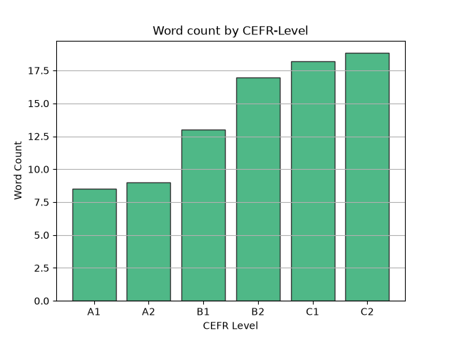
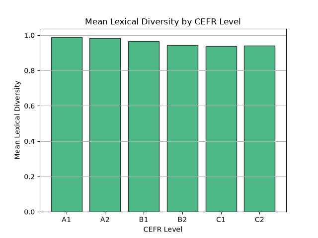
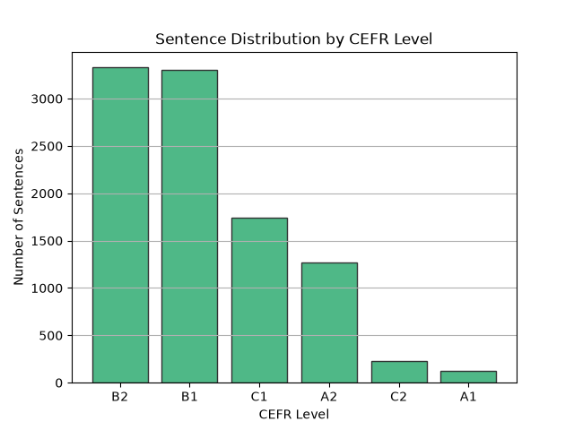
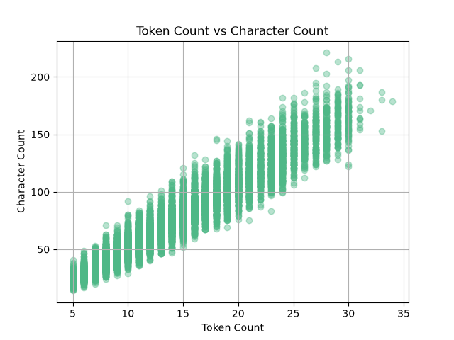
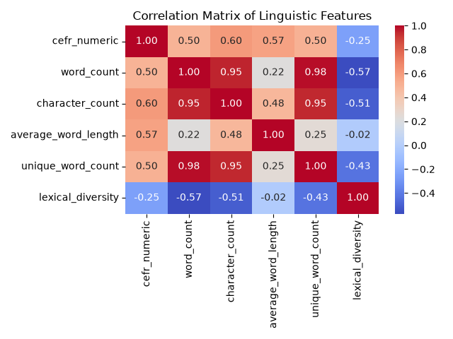
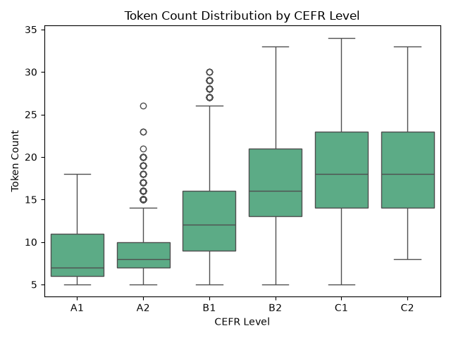
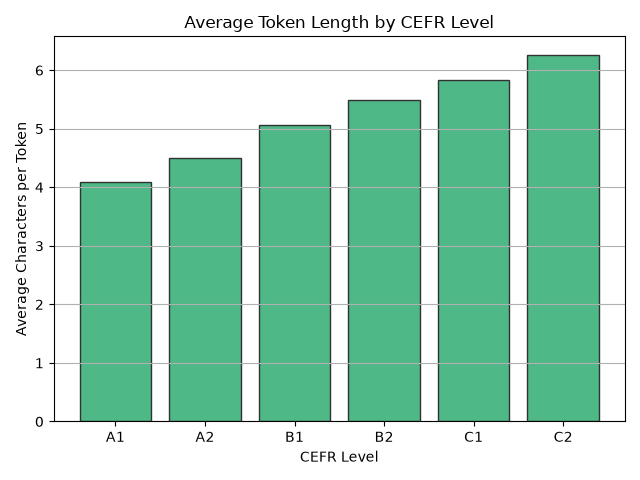

# CEFR Sentence Difficulty Analyzer

Exploring linguistic patterns across English proficiency levels using Pandas, Matplotlib, and Seaborn.

## Overview

The **CEFR Sentence Difficulty Analyzer** is a data analysis project that explores how surface-level linguistic features vary across English proficiency levels from **A1 to C2**.

The project uses the **CEFR-SP English dataset** and applies data cleaning, text feature engineering, Pandas-based analysis, and data visualization to investigate patterns related to sentence length, token length, vocabulary diversity, and CEFR level.

The project is designed as a foundation for future NLP applications related to **English difficulty estimation and personalized language learning**.

---

## Problem

Language-learning systems need ways to estimate the difficulty of learning materials.

This project investigates a simple question:

> **What linguistic patterns can be observed across English sentences at different CEFR proficiency levels?**

The analysis focuses on several measurable textual features and examines how they change from A1 to C2.

---

## Dataset

The project uses the **CEFR-SP English dataset** from Hugging Face:

**CEFR-SP English Dataset:**

https://huggingface.co/datasets/UniversalCEFR/cefr_sp_en

The original dataset contains approximately **10,004 English sentences** labeled with CEFR levels from A1 to C2.

The dataset includes metadata such as:

* `title`
* `lang`
* `source_name`
* `format`
* `category`
* `cefr_level`
* `license`
* `text`

After removing one duplicate row, the final dataset contains **10,003 sentences**.

---

## Data Cleaning

The following checks and cleaning steps were performed:

* Inspected the dataset structure and data types
* Checked for missing values
* Identified duplicate rows
* Removed duplicate rows
* Verified CEFR level values
* Checked for empty or whitespace-only text
* Verified that text values were not missing
* Examined the distribution of sentences across CEFR levels

The final dataset contains:

* **10,003 rows**
* **8 original columns**
* **0 duplicate rows**
* **0 missing text values**
* **0 empty text entries**

---

## Feature Engineering

Several text-based features were created using Pandas string operations.

### Token Count

Counts whitespace-separated tokens in each sentence.

```python
df["word_count"] = df["text"].str.split().str.len()
```

### Character Count

Counts all characters, including spaces and punctuation.

```python
df["character_count"] = df["text"].str.len()
```

### Unique Token Count

Counts unique whitespace-separated tokens within each sentence.

```python
df["unique_word_count"] = (
    df["text"].str.split().apply(lambda words: len(set(words)))
)
```

### Average Characters per Token

Calculates the average number of characters per whitespace-separated token.

```python
df["average_word_length"] = (
    df["character_count"] / df["word_count"]
)
```

### Lexical Diversity

Measures the ratio of unique tokens to total tokens.

```python
df["lexical_diversity"] = (
    df["unique_word_count"] / df["word_count"]
)
```

---

## Analysis

Pandas operations used throughout the project include:

* `groupby()`
* `agg()`
* `value_counts()`
* `sort_values()`
* `query()`
* `diff()`
* `pct_change()`
* `corr()`
* `idxmax()`
* `idxmin()`

The main analysis compares the engineered linguistic features across CEFR levels.

An ordinal numerical representation of CEFR was also created:

```text
A1 → 1
A2 → 2
B1 → 3
B2 → 4
C1 → 5
C2 → 6
```

This encoding was used only to examine approximate relationships between the ordered CEFR levels and the engineered features.

---

## Visualizations

The project includes seven visualizations generated with Matplotlib and Seaborn:

1. **Mean Token Count by CEFR Level**
2. **Mean Lexical Diversity by CEFR Level**
3. **Sentence Distribution by CEFR Level**
4. **Token Count vs Character Count**
5. **Correlation Matrix of Linguistic Features**
6. **Token Count Distribution by CEFR Level**
7. **Average Token Length by CEFR Level**

The visualization files are available in the `visualizations/` directory.

### Mean Token Count by CEFR Level



### Mean Lexical Diversity by CEFR Level



### Sentence Distribution by CEFR Level



### Token Count vs Character Count



### Correlation Matrix of Linguistic Features



### Token Count Distribution by CEFR Level



### Average Token Length by CEFR Level



## Findings

The analysis revealed several linguistic patterns across CEFR levels in the CEFR-SP English dataset.

* **Token count generally increases with CEFR level.**
  Mean token count increased from approximately 8.50 at A1 to 18.83 at C2.

* **Character count follows a similar increasing pattern.**
  Mean character count increased from approximately 34.53 characters at A1 to 117.13 at C2.

* **Average characters per token increase across CEFR levels.**
  The average increased from approximately 4.10 at A1 to 6.27 at C2.

* **Unique token count increases with CEFR level.**
  Mean unique token count increased from approximately 8.35 at A1 to 17.55 at C2.

* **Lexical diversity does not follow a monotonic pattern.**
  Mean lexical diversity decreased from A1 through C1 and then increased slightly at C2.

* **Character count had the strongest positive correlation with the ordinal CEFR encoding among the engineered features.**
  The correlation was approximately **r = 0.60**.

These findings describe patterns observed in this dataset and should not be interpreted as universal properties of CEFR levels or English language complexity.

---

## Limitations

This analysis has several limitations.

### Simple Tokenization

Tokens were approximated using whitespace separation. This approach does not fully handle punctuation, contractions, or other linguistic structures.

### Approximate Token Length

The `average_word_length` feature includes spaces and punctuation in the character count. Therefore, it is more accurately interpreted as **average characters per whitespace-separated token**, rather than precise linguistic word length.

### Ordinal CEFR Encoding

CEFR levels were mapped from A1 to C2 using values from 1 to 6.

This represents their ordering, but the numerical distances between CEFR levels should not be interpreted as equal intervals.

### Dataset Imbalance

The number of sentences differs substantially between CEFR levels.

B1 and B2 contain the largest number of examples, while A1 and C2 contain considerably fewer examples. Comparisons involving smaller groups should therefore be interpreted with caution.

### Correlation Does Not Imply Causation

The observed correlations describe relationships between features and the ordinal CEFR encoding. They do not establish causal relationships.

### Limited Linguistic Features

This project focuses mainly on surface-level textual features.

More advanced linguistic properties such as:

* syntactic complexity
* part-of-speech patterns
* morphological richness
* dependency structures
* semantic complexity

were not included.

---

## Future Work

This project can be extended toward more advanced NLP-based analysis.

### Improved Linguistic Features

Future versions could include:

* syntactic complexity
* part-of-speech distributions
* morphological features
* dependency-based features
* improved tokenization
* linguistic complexity measures

### Advanced NLP Analysis

NLP techniques could be used to investigate how vocabulary, grammar, syntax, and semantic complexity vary across CEFR levels.

### Sentence Difficulty Estimation

The engineered features could serve as initial signals for developing a system that estimates the difficulty of English sentences.

### Machine Learning

The dataset could later be used to train and evaluate machine-learning models for CEFR-related prediction tasks.

### Multilingual Extension

The same methodology could be applied to other languages to investigate whether similar linguistic patterns appear across different language-learning datasets.

---

## PandaLearn Connection

This project is also a foundation for future development of **PandaLearn**, a language-learning AI platform.

The long-term goal is to move from simple linguistic analysis toward systems that can understand the difficulty of learning materials and support personalized learning.

Potential applications include:

* estimating the difficulty of reading materials
* recommending sentences appropriate for a learner's level
* adapting exercises to learner proficiency
* analyzing vocabulary and grammatical complexity
* supporting personalized language-learning paths

The current project does **not** claim to provide a complete difficulty classifier. Instead, it explores linguistic features that could later become inputs to more advanced NLP and machine-learning systems.

---

## Technologies

* Python
* Pandas
* NumPy
* Matplotlib
* Seaborn

---

## Project Structure

```text
cefr-sentence-difficulty-analyzer/
├── data/
│   └── cefr-sp.json
├── visualizations/
│   ├── word_count_by_cefr.png
│   ├── lexical_diversity_by_cefr.png
│   ├── cefr_distribution.png
│   ├── token_vs_character_count.png
│   ├── correlation_heatmap.png
│   ├── token_count_boxplot.png
│   └── average_token_length.png
├── analysis.py
├── requirements.txt
└── README.md
```

---

## Project Goal

The goal of this project is to build a practical foundation for **NLP-oriented data analysis** by connecting Pandas and linguistic analysis to a real language-learning application.

This project represents the transition from general data manipulation toward **Computational Linguistics, NLP, and language-learning AI**.
